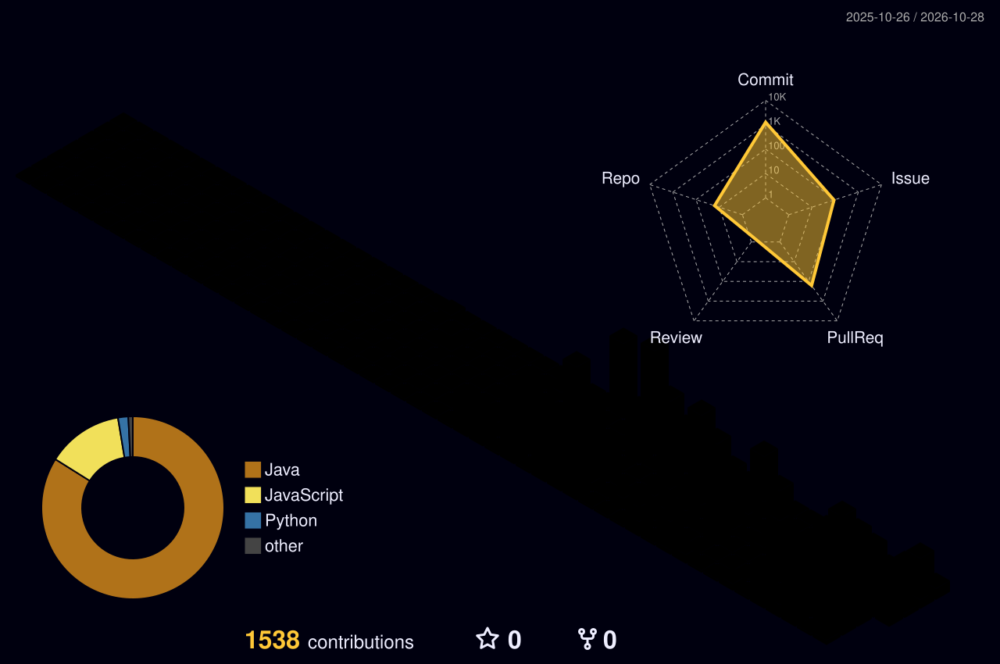

# 김지형 · Backend Developer

안정적인 메시지 전달과 측정에 기반한 성능 개선에 관심이 있는 백엔드 개발자입니다.

### 기술

### 프로젝트

**[여담](https://github.com/100-hours-a-week/KTB4-2nd-BE)**  
여행 사진과 이야기를 정리하는 서비스. 별도 사진 분석 AI 서비스와 연결되는 백엔드입니다.  
Java · Spring Boot · JPA · MySQL · Redis · Kafka · Outbox · Debezium · S3

**[하비루프](https://github.com/100-hours-a-week/KTB4_Jayden_Week12_BE)**  
취미를 공유하는 피드와 1:1 채팅 서비스. 게시글·댓글·좋아요·이미지와 JWT 인증을 제공합니다.  
Java · Spring Boot · MySQL · JPA/JDBC · Redis Pub/Sub · WebSocket/STOMP · Outbox · Docker · EC2

### 관심사

- 멀티 인스턴스 환경에서의 안정적인 백엔드와 메시지 전달
- 측정 결과에 기반한 비동기 처리·데이터베이스 최적화
- 테스트와 CI를 통한 팀 개발 생산성 향상

### GitHub 활동

Total Commits는 올해 기준입니다. 기여 수는 커밋 수와 다릅니다.

공개 활동 기반이며 매일 갱신됩니다. 첫 워크플로 실행 후 실제 통계와 3D 달력이 표시됩니다.
